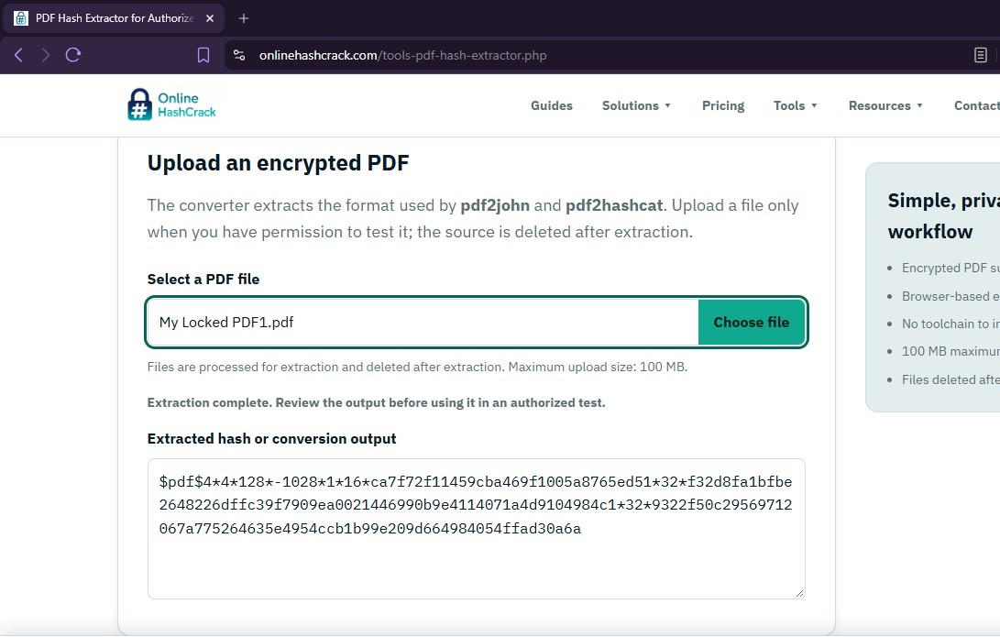
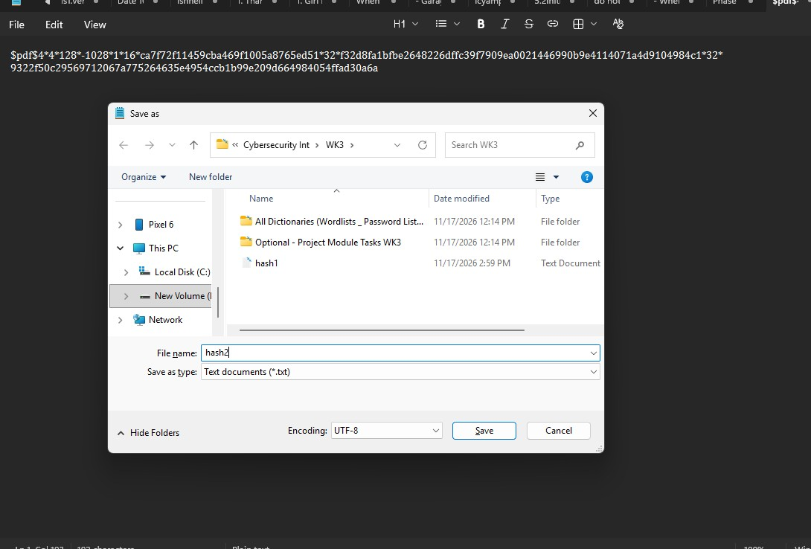
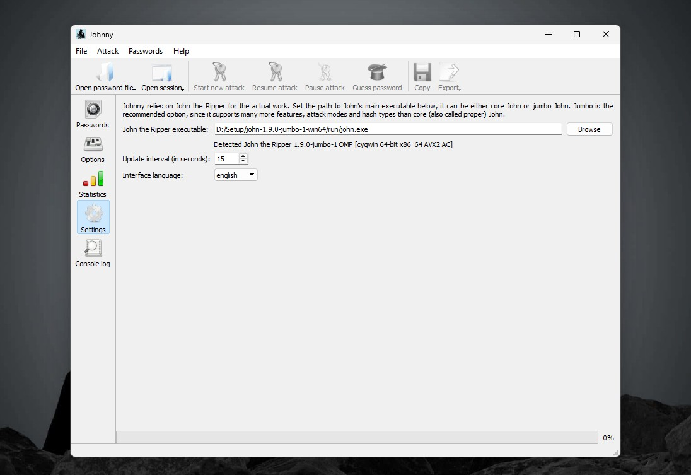
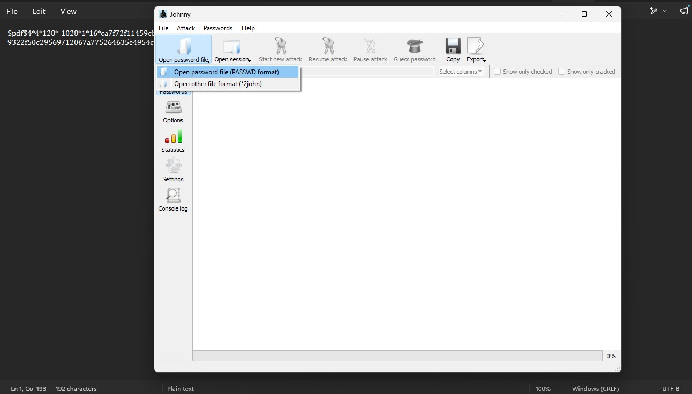

# PENETRATION TESTING REPORT
 
## PASSWORD CRACKING PHASE
 
**W3-PM-FINAL | CYBERSECURITY | NETWORKWALKS**
 
| | |
|---|---|
| **Pentester Name (Cybersecurity Professional)** | **GABIRO Vladimir Brenn** |
| **Program/Batch** | B084C-Networkwalks |
| **Date** | 17 November 2026 |
| **Modules completed** | W3-PM1 (Password Cracking – Offline, with John the Ripper)<br>W3-PM2 (Password Cracking – Online, with Networkwalks tools) |
| **Permission secured from client?** | Yes (own files, created for the exercise) |
 
---
 
## 1. Liability Disclaimer
 
I have performed these activities only on the systems & devices where I had secured written permission or the devices/systems that I own myself. All these materials are for education and research purpose only. Do not use anything from here to break the law. The instructor, the authors and Networkwalks are not responsible for what you do with this knowledge. Every action you take is your own responsibility. Misuse can lead to criminal charges, heavy fines, loss of your job and a permanent record. In most countries unauthorised access is a crime even when nothing is damaged.
 
---
 
## 2. Introduction
 
This report covers the Week 3 practical: recovering the password of two encrypted PDF files using password-cracking techniques. The goal was to practice two different approaches to the same problem:
 
- **W3-PM1:** extracting the PDF's crackable hash with an online hash-extraction tool, then cracking it **offline** with **John the Ripper**, using its GUI front-end **Johnny**.
- **W3-PM2:** extracting the hash and running the attack entirely through **Networkwalks' own browser-based lab tools** (Hash Calculator and Password Cracker), which simulate the same dictionary-attack logic that John the Ripper uses.
Both PDFs were created by me specifically for this exercise, so no third-party permission was needed. All activities were performed on 17 November 2026.
 
---
 
## 3. Tools Used
 
| Tool | Purpose |
|---|---|
| Online Hash Crack – PDF Hash Extractor (`onlinehashcrack.com`) | Extract a `pdf2john`/`hashcat`-compatible crackable hash from an encrypted PDF. |
| Networkwalks Hash Calculator (`networkwalks.com/hash-calculator/`) | Extract a crackable hash from an encrypted PDF, processed locally in the browser. |
| John the Ripper (jumbo build) | Password-cracking engine used to run the dictionary attack offline. |
| Johnny | Graphical front-end for John the Ripper, used to load the hash and run/monitor the attack. |
| Networkwalks Password Cracker – Dictionary Attack Lab (`networkwalks.com/password-cracker/`) | Browser-based simulator that hashes a wordlist and matches it against a pasted PDF hash. |
 
---
 
## 4. Activities Performed
 
### 4.1 Task 1 – Offline cracking with John the Ripper / Johnny (`My Locked PDF1.pdf`)
 
**Step 1 – Extract the PDF hash**
 
I uploaded `My Locked PDF1.pdf` to the Online Hash Crack **PDF Hash Extractor** tool, which parses the PDF locally and returns a crackable hash without storing the file.
 
```text
$pdf$4*4*128*-1028*1*16*ca7f72f11459cba469f1005a8765ed51*32*f32d8fa1bfbe2648226dffc39f7909ea0021446990b9e4114071a4d9104984c1*32*9322f50c29569712067a775264635e4954ccb1b99e209d664984054ffad30a6a
```
 

 
**Step 2 – Save the hash to a text file**
 
I saved the extracted hash as a `.txt` file inside my working folder (`Cybersecurity Int\WK3`) so it could be loaded into Johnny.
 

 
**Step 3 – Configure Johnny**
 
In Johnny's **Settings** tab, I pointed the "John the Ripper executable" field to the Jumbo build of John (`D:/Setup/john-1.9.0-jumbo-1-win64/run/john.exe`). Johnny confirmed the detected version: John the Ripper 1.9.0-jumbo-1 OMP (cygwin 64-bit x86_64 AVX2 AC).
 

 
**Step 4 – Load the hash file**
 
From the **Passwords** tab (empty at first), I used **Open password file → Open other file format (\*2john)** to import the saved hash file into Johnny.
 

 

 
**Step 5 – Run the attack and recover the password**
 
I started the attack from Johnny. It ran John the Ripper against the hash in the background and found a match:
 
| User | Password | Hash format | Result |
|---|---|---|---|
| `?` | **`good-luck`** | PDF | 1 cracked / 0 left (100%) |
 

 
**Step 6 – Verify the password**
 
I opened `My Locked PDF1.pdf` and entered `good-luck`. The file unlocked successfully and displayed the lab's "Congratulations" confirmation page.
 

 
---
 
### 4.2 Task 2 – Online cracking with Networkwalks tools (`My Locked PDF2.pdf`)
 
**Step 1 – Extract the PDF hash**
 
I opened the Networkwalks **Hash Calculator** tool, selected the **PDF** tab, and uploaded `My Locked PDF2.pdf` (204.7 KB). The tool confirmed the file is encrypted and extracted a crackable hash (Revision R4, Version V4, Key length 128-bit), entirely client-side ("nothing is uploaded, the PDF is parsed locally"):
 
```text
$pdf$4*4*128*-1028*1*16*0853f2cde0ef15b1c0f93ed229d3b1ad*32*8f13ce5aa39ad974364d36a057da76790021446990b9e4114071a4d9104984c1*32*ceecdac74b19b5a62688d3b3524e1374c955cbb9cc3c45316494d9446ef81af1
```
 

 
**Step 2 – Run the dictionary attack**
 
I pasted the hash into Networkwalks' **Password Cracker (Dictionary Attack Lab)**, which hashes every word in a wordlist and compares it against the pasted PDF hash, the same idea John the Ripper uses internally. I used the tool's **built-in wordlist (100 passwords)**.
 
**Step 3 – Observe the attack and recover the password**
 
The tool worked through the list at about 9 passwords/second, testing common and weak passwords (`service`, `canada`, `hockey`, `killer`, `george`, `asdfgh`, `zxcvbn`, `qwertyuiop`, `111222`, …). At attempt 91 of 100 it found a match:
 
| Attempts | Speed | Result |
|---|---|---|
| 91 / 100 (91%) | 9 pw/s | **`password1`** ✔ |
 

 
**Step 4 – Verify the password**
 
With the password `password1` recovered, the PDF could be opened and unlocked in the same way as Task 1.
 
---
 
## 5. Conclusion
 
In Week 3 of my Cybersecurity internship, I practiced password cracking on two self-created, encrypted PDF files using two different methods.
 
In Task 1, I extracted the PDF's hash with an online extraction tool, loaded it into **John the Ripper** through its **Johnny** GUI, and recovered the password `good-luck` through a dictionary-style attack, then verified it by opening the PDF.
 
In Task 2, I used Networkwalks' own **Hash Calculator** and **Password Cracker** lab tools to extract a second PDF's hash and run a 100-word dictionary attack entirely in the browser, recovering the password `password1`.
 
This exercise showed me how quickly a weak password can be recovered once an attacker has access to its hash, whether using a professional offline tool like John the Ripper or a simple browser-based dictionary attack. It reinforced why password strength, not just the strength of the encryption algorithm, is what actually protects a file, and why password-cracking tools should only ever be used on systems and files I am authorized to test.
 
---
 
-End-
 
**👤 Author**
 
**GABIRO Vladimir Brenn**
Cybersecurity Professional B082
 
**📌 Project Information**
 
**Program Name:** Cybersecurity program at Networkwalks | **Week:** 03 | **Repository:** GitHub
 
